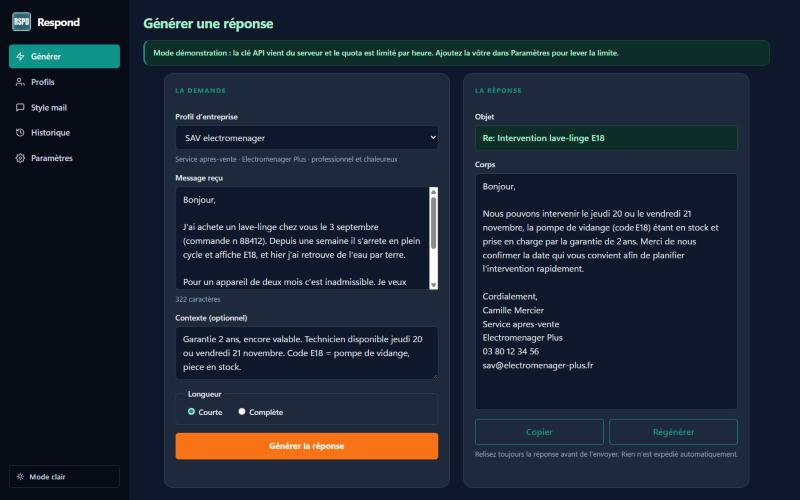
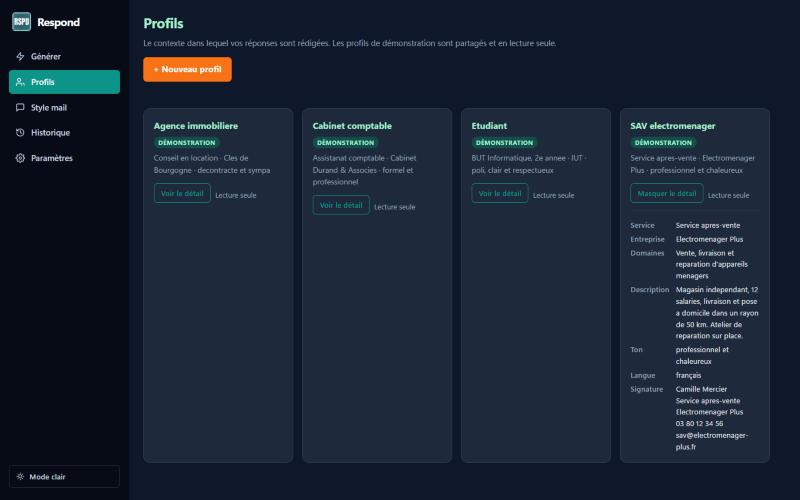
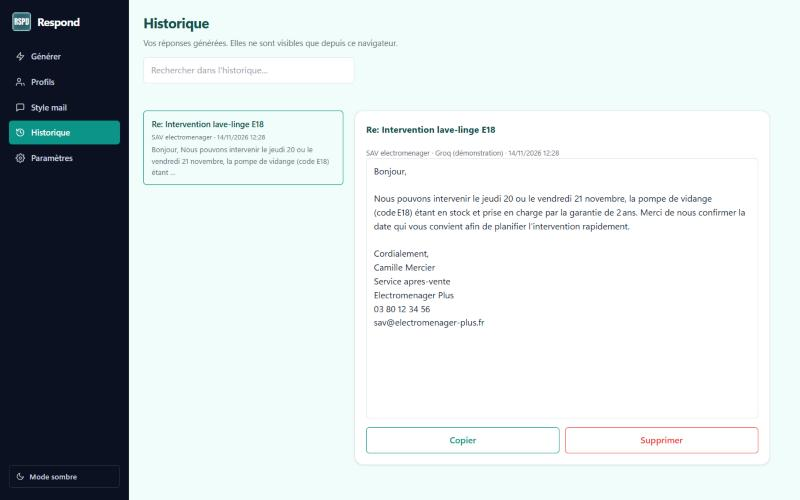

# Respond

Générateur de réponses à des emails professionnels, propulsé par une API d'IA.
Application web ASP.NET Core avec un client JavaScript, architecture en quatre
projets.

**→ [Essayer la démonstration](https://respond-myp9.onrender.com/)**

Aucun compte, aucune installation : choisissez un profil, collez un email,
cliquez. La clé API vient du serveur. L'hébergement est gratuit, donc le
service s'endort après quinze minutes sans visite — la première page peut
mettre une minute à venir.

## Ce que ça fait

Vous choisissez un profil d'entreprise — métier, ton, signature — vous collez
l'email auquel répondre, et l'application rédige une réponse prête à relire.
Rien n'est jamais envoyé automatiquement : vous relisez toujours avant.



Le champ *Contexte* porte ce que l'IA ne peut pas deviner — ici les créneaux
d'intervention et la cause de la panne. Sans lui, la réponse promet un rappel ;
avec lui, elle propose deux dates.

### Les profils



Un profil décrit le métier, le ton et la signature. Quatre sont fournis pour
qu'un visiteur puisse générer sans rien remplir ; les siens s'ajoutent à côté.

### L'historique



Sans compte, et pourtant séparé : un cookie de session anonyme et signé
cloisonne les visiteurs. Le thème clair ou sombre suit le système par défaut
et se force d'un clic.

## Pile technique

| Couche | Technologie |
|---|---|
| Langage | C# / .NET 10 |
| API | ASP.NET Core, contrôleurs |
| Persistance | Entity Framework Core — SQLite en local, PostgreSQL en production |
| Client | JavaScript natif, structure MVC, aucune dépendance |
| Tests | xUnit, doublures écrites à la main |

## Architecture

```
RespondMetier/   ← métier pur, ne référence aucun projet
RespondData/     ← persistance, implémente les interfaces du métier
RespondAPI/      ← contrôleurs, clients des fournisseurs, client web
RespondTests/    ← tests unitaires et tests d'architecture
```

La règle centrale : **`RespondMetier` ne référence rien.** Il déclare ce dont il
a besoin sous forme d'interfaces, les autres couches les implémentent. C'est ce
qui l'a laissé intact le jour où la présentation est passée d'une application
de bureau WPF à une API web : un seul projet sur quatre a changé.

## Sécurité

Chaque point ci-dessous est une décision, pas un réglage par défaut.

- **Aucun compte, et pourtant des données cloisonnées.** Un cookie de session
  anonyme sépare les visiteurs. Sa valeur est signée cryptographiquement : un
  identifiant brut serait forgeable, il suffirait de recopier celui d'un autre
  pour lire son historique. Cookie `HttpOnly`, `SameSite=Lax`, `Secure` hors
  développement, identifiant de 32 octets tirés du générateur cryptographique.
  Les clés de signature vivent en base, donc elles survivent au redéploiement
  et sont partagées par toutes les instances.
- **Injection de prompt.** L'email reçu est une donnée non fiable. Instructions
  et message voyagent comme deux messages distincts, jamais concaténés, et le
  modèle est explicitement instruit de ne pas obéir au contenu analysé. Aucune
  de ces défenses n'étant absolue, rien n'est jamais envoyé automatiquement.
- **Clés API.** Jamais dans le dépôt, jamais dans un log, jamais dans un
  message d'erreur. `CleApi.ToString()` est redéfini pour ne pas pouvoir
  révéler le secret par accident. Un test le vérifie.
- **Limitation de débit** par adresse sur la génération, et plafond sur la
  taille des messages : la démonstration tourne sur une clé partagée.
- **En-têtes** : politique de sécurité du contenu stricte envoyée en en-tête
  HTTP et non en balise `meta`, `nosniff`, `Referrer-Policy`, HSTS en
  production, en-tête `Server` supprimé.
- **Aucune ressource tierce.** Pas de polices distantes, donc aucune adresse IP
  de visiteur transmise à qui que ce soit.
- **Aucune dépendance JavaScript.** Le client est écrit à la main.

## Démarrage

Prérequis : [SDK .NET 10](https://dotnet.microsoft.com/download).

```
dotnet restore
dotnet test
dotnet run --project RespondAPI
```

Pour activer le mode démonstration, enregistrez une clé
[Groq](https://console.groq.com/keys) hors du dépôt :

```
dotnet user-secrets set "Respond:CleDemo" "votre_cle" --project RespondAPI
```

## Déploiement

L'application se construit en image Docker et se déploie sur
[Render](https://render.com), avec une base PostgreSQL chez
[Neon](https://neon.com). Les deux offres gratuites suffisent et ne demandent
pas de carte bancaire.

### Deux moteurs de base, un seul code

| Environnement | Moteur | Pourquoi |
|---|---|---|
| Développement | SQLite | Un fichier, rien à installer |
| Production | PostgreSQL | L'hébergement gratuit ne fournit pas de disque persistant |

Le moteur est déduit de la chaîne de connexion, pas d'un réglage séparé : une
chaîne PostgreSQL et un moteur SQLite ne peuvent donc pas se contredire.

Les hébergeurs publient leur base sous forme d'URL
(`postgresql://utilisateur:secret@hôte/base`), une forme que Npgsql n'accepte
pas — il attend des paires `clé=valeur`. La conversion est isolée dans
`ChaineConnexion`, à part du démarrage, parce qu'une fonction pure se teste.

### Rien à monter

Les clés qui signent les cookies de session vivent **en base**, avec le reste
des données. Auparavant elles étaient écrites dans un dossier, ce qui imposait
un volume persistant et interdisait toujours plusieurs instances : chacune
aurait eu ses propres clés, et un visiteur aurait changé d'identité à chaque
requête. Ces lignes sont un secret — qui les lit peut forger un cookie de
session — et ne sont exposées par aucune route.

Le conteneur est donc **sans état** : il se redéploie, se duplique et se jette
sans que personne ne perde son historique.

### Variables d'environnement

| Variable | Rôle |
|---|---|
| `ConnectionStrings__Default` | L'URL PostgreSQL fournie par Neon |
| `Respond__CleDemo` | Clé Groq du mode démonstration. **Jamais dans l'image ni dans le dépôt.** |

`render.yaml` décrit le service et déclare ces deux variables en `sync: false`,
c'est-à-dire saisies dans l'interface et absentes du dépôt. Mettre la
configuration de production sous contrôle de version lui donne un auteur, une
date et une justification, ce qu'un réglage changé à la main dans une
interface n'a pas. Un secret, lui, n'y a pas sa place : une fois poussé, il
reste lisible dans l'historique même après avoir été retiré.

### Derrière un proxy

L'hébergeur termine TLS et transmet la requête en clair. Sans lire les
en-têtes qu'il ajoute, l'application se croit en HTTP, redirige vers HTTPS, et
le navigateur boucle.

`ForwardLimit` vaut 1, et ce n'est pas un détail : `X-Forwarded-For` est une
liste à laquelle n'importe qui peut ajouter une entrée avant d'atteindre le
proxy. ASP.NET la lit par la droite, donc la dernière entrée, celle que le
proxy a écrite lui-même. Accepter plus loin reviendrait à croire le client sur
parole, et la limitation de débit, qui partitionne par adresse, se
contournerait en ajoutant un en-tête.

### En local

```
docker build -t respond .
```

```
docker run -p 8080:8080 -e Respond__CleDemo="votre_cle" -v respond-donnees:/donnees respond
```

## Intégration continue

Quatre contrôles tournent à chaque poussée et chaque pull request :

- compilation et tests sur Linux, avec rapport de couverture ;
- recherche de paquets vulnérables, dépendances transitives comprises ;
- recherche de secrets avec `gitleaks` sur **tout l'historique**, pas seulement
  sur le dernier commit — une clé supprimée plus tard reste lisible dans le
  commit qui l'a introduite. Cette analyse tourne aussi chaque lundi, parce
  qu'une clé publiée aujourd'hui peut n'être reconnue comme telle que demain ;
- construction de l'image Docker.

Les tests tournent **pendant** la construction de l'image, pas à côté : aucune
image ne peut donc être produite à partir d'un code dont les tests échouent.

## Méthode de travail

Projet développé avec l'assistance d'un agent IA. Les choix d'architecture, les
conventions de code et les arbitrages techniques sont documentés dans les
messages de commit, qui expliquent systématiquement le *pourquoi* d'une
décision et pas seulement ce qu'elle change.

## Licence

MIT
